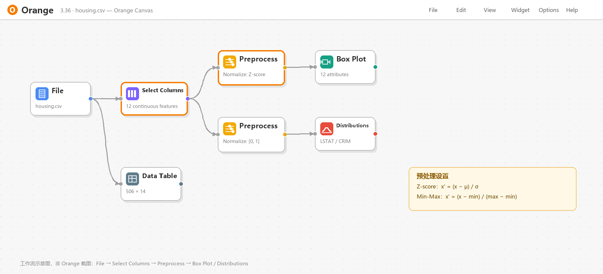

# orange-data-mining

一个给 **DSH（DeepSeek Harness）** 用的 Orange3 数据挖掘技能包。它把 Orange3 的控件语义、预处理口径、常用工作流和“无 GUI 时的示意图渲染”整理成可按需加载的 skill，避免每次从零解释 Orange。



> 上图是 `scripts/orange_style_diagram.py` 生成的**示意图**，不是 Orange 截图。

## 包含什么

```text
orange-data-mining/
├── SKILL.md                      # 技能入口：何时使用、环境判断、控件/预处理/评估要点
├── references/
│   ├── widgets.md                # Data/Transform/Visualize/Model/Evaluate/Unsupervised 控件表
│   └── workflows.md              # 标准化对比、分类、回归、聚类、缺失值、文本 6 条配方
├── scripts/
│   ├── check_orange.py           # 检测当前解释器 / ORANGE_PYTHON / D:\orange 等独立环境
│   └── orange_style_diagram.py   # 用 JSON 规格绘制 Orange Canvas 风格示意图
└── assets/
    ├── housing_normalize.json    # 示例规格：File → Select Columns → 两个 Preprocess → Box Plot/Distributions
    └── example.png               # 示例输出
```

## 安装

把整个目录放到 DSH 的用户级技能目录：

- Windows：`%USERPROFILE%\.dsh\skills\orange-data-mining\`
- macOS / Linux：`~/.dsh/skills/orange-data-mining/`

确认入口文件存在：

```text
.../skills/orange-data-mining/SKILL.md
```

DSH 的 filesystem skill provider 会自动扫描 `SKILL.md`，新增或修改后通常不需要重启；新会话会看到 `orange-data-mining`。

## 快速开始

检查环境：

```bash
python scripts/check_orange.py
```

它会区分：

- 当前解释器是否安装 Orange
- 是否有 PyQt/图形会话
- 是否发现独立环境，例如：

```text
external-orange: D:\orange\python.exe (3.40.0)
```

用独立环境启动 Orange：

```bash
"D:\orange\python.exe" -m Orange.canvas
```

生成示意图：

```bash
python scripts/orange_style_diagram.py assets/housing_normalize.json out.png
```

## 设计原则

1. **示意图不等于截图。** 没有实际打开 Orange，就不能写“Orange 截图/运行结果”，只能写“按 Orange3 工作流逻辑设计”“工作流示意”。
2. **数值结果要说明来源。** 用 pandas/numpy 算的，就写 pandas/numpy；用 Orange 跑的，才写 Orange。
3. **能复现。** 给出控件链、关键参数、数据文件和评估设置。
4. **不伪造。** 没有 GUI 就生成示意图或请用户提供截图，不拿绘制图冒充软件界面。

## 环境与依赖

- Python 3.10+（渲染脚本需要 Pillow）
- Orange3 可选；GUI 需要 PyQt5 和桌面会话
- 已在 **Orange 3.40.0 + Python 3.12 + Windows 11** 下验证过：
  - `Normalize(norm_type=Normalize.NormalizeBySD)`（Z-Score）
  - `Normalize(norm_type=Normalize.NormalizeBySpan, zero_based=True)`（Min-Max）
  - 内置 `housing` 数据集 506 行 × 12 个连续属性：IQR 异常值 308，`|Z|>3` 65

## 说明

- 仓库不包含任何数据文件或凭据；`housing_normalize.json` 只描述工作流结构。
- `.ows` 文件建议在 Orange GUI 中保存模板后再改参数，不要凭空手写复杂 XML。
- 这个 skill 是给 DSH 的本地说明包，不会改变模型权重；新会话按需加载。
